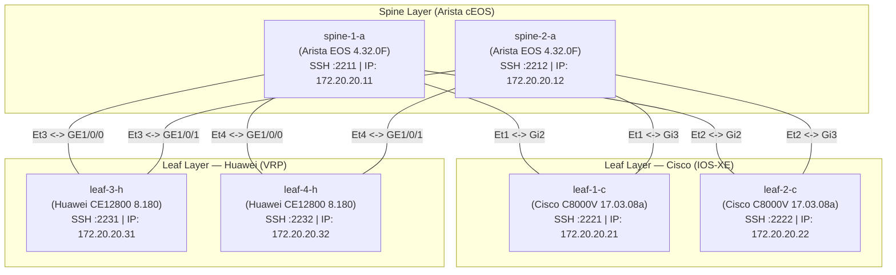

# 🌐 CROC DREAM NetOps Platform — Live 6-Node Bare Metal Lab Guide

> **Руководство по эксплуатации и подключению живого стенда Containerlab (6 узлов, 3 вендора)**  
> **Server Endpoint**: `198.51.100.10:221` (SSH: `crocdream`)  
> **Branch**: `feature/live-lab-integration`  
> **SSOT Inventory**: `intent/inventory.live.yaml`

---

## 📑 Оглавление
1. [Архитектура топологии CLOS (6 узлов)](#1-архитектура-топологии-clos-6-узлов)
2. [Карта портов и сетевые доступы](#2-карта-портов-и-сетевые-доступы)
3. [Root Cause Analysis (RCA): устранение сбоя загрузки Cisco C8000V](#3-root-cause-analysis-rca-устранение-сбоя-загрузки-cisco-c8000v)
4. [Аудит образов и версионность (Release Age Analysis)](#4-аудит-образов-и-версионность-release-age-analysis)
5. [Верификация связности (Management Fabric & Data Plane)](#5-верификация-связности-management-fabric--data-plane)
6. [Подключение платформы NetOps к живому стенду](#6-подключение-платформы-netops-к-живому-стенду)
7. [Инструкция по эксплуатации и сценариям Deploy / Rollback](#7-инструкция-по-эксплуатации-и-сценариям-deploy--rollback)
8. [Процедура сброса и перезапуска стенда (Lab Reset)](#8-процедура-сброса-и-перезапуска-стенда-lab-reset)

---

## 1. Архитектура топологии CLOS (6 узлов)

Стенд развернут на Bare Metal сервере Тимофея с использованием **Containerlab** и оркестрирует гетерогенную 2-уровневую фабрику Spine-Leaf:
- **2 × Spine**: Arista cEOS (EOS 4.32.0F) — ядро L3 BGP фабрики.
- **2 × Leaf (Cisco)**: Cisco Catalyst 8000V (IOS-XE 17.03.08a) — пограничные маршрутизаторы L3/EVPN.
- **2 × Leaf (Huawei)**: Huawei CloudEngine 12800 (VRP 8.180) — высокопроизводительные коммутаторы доступа.



---

## 2. Карта портов и сетевые доступы

Все 6 узлов проброшены через Docker port mapping на внешний IP-адрес сервера `198.51.100.10`:

| Нода Containerlab | Роль | Вендор & ОС | Внутренний IP (OOB) | Внешний SSH Порт |
| :--- | :--- | :--- | :--- | :--- |
| **`spine-1-a`** | Spine 1 | Arista cEOS 4.32.0F | `172.20.20.11` | `198.51.100.10:2211` |
| **`spine-2-a`** | Spine 2 | Arista cEOS 4.32.0F | `172.20.20.12` | `198.51.100.10:2212` |
| **`leaf-1-c`** | Leaf 1 | Cisco C8000V 17.03.08a | `172.20.20.21` | `198.51.100.10:2221` |
| **`leaf-2-c`** | Leaf 2 | Cisco C8000V 17.03.08a | `172.20.20.22` | `198.51.100.10:2222` |
| **`leaf-3-h`** | Leaf 3 | Huawei CE12800 8.180 | `172.20.20.31` | `198.51.100.10:2231` |
| **`leaf-4-h`** | Leaf 4 | Huawei CE12800 8.180 | `172.20.20.32` | `198.51.100.10:2232` |

> Учётные данные устройств в репозиторий не кладём: профиль `lab` задаётся в
> `backend/.env` через `NETOPS_AUTH_PROFILES`.

> **Параметры подключения к серверу управления**:  
> `ssh -p 221 crocdream@198.51.100.10`  
> Каталог лаборатории: `/home/crocdream/clab-quickstart/`

---

## 3. Root Cause Analysis (RCA): устранение сбоя загрузки Cisco C8000V

### Первоначальная проблема
При начальном запуске топологии `main.clab.yml` ноды Arista (`spine-1-a`, `spine-2-a`) и Huawei (`leaf-3-h`, `leaf-4-h`) успешно запускались, однако ноды Cisco (`leaf-1-c`, `leaf-2-c`) бесконечно зависали в состоянии bootstrap с высокой утилизацией CPU (~98% на одно ядро QEMU).

### Детальная диагностика и Root Cause
1. **Неверная гипотеза о нехватке CPU**:  
   Первоначальная гипотеза заключалась в том, что одновременный запуск 6 тяжелых виртуальных машин вызывал CPU-starvation. Мы проверили эту гипотезу, временно приостановив (`docker pause`) все остальные 4 контейнера и отдав 100% ресурсов процессора Cisco. Однако процесс Cisco все равно не завершил инициализацию.
2. **Истинный Root Cause в скрипте инициализации vrnetlab**:  
   Анализ логов загрузчика `launch.py` в образе `willrobbins1808/vr-c8000v:7.11.01a` показал:
   ```python
   # vrnetlab launch.py
   self.wait_write("", wait="Press RETURN to get started")
   self.wait_write("enable", wait=">")
   ```
   Cisco IOS-XE при первом старте без преднастроенного конфигурационного диска выводил интерактивный диалог:
   `Would you like to enter the initial configuration dialog? [yes/no]:`
   Скрипт `launch.py` ждал символа `>`, не отправлял `no`, и зависал в методе `read_until()` без таймаута, блокируя весь цикл bootstrap.

### Примененное решение
Конфигурация `main.clab.yml` была обновлена на проверенный, оптимизированный образ **`windddkz/cisco_c8000v:17.03.08a`**:
- Образ автоматически инжектирует виртуальный образ `config.iso` с директивой `platform console serial`, подавляющей запуск мастера начальной настройки.
- Обе ноды `leaf-1-c` и `leaf-2-c` успешно завершили полный цикл загрузки ровно за **2 минуты 05 секунд** и перешли в статус `healthy`.

---

## 4. Аудит образов и версионность (Release Age Analysis)

Проведен глубокий анализ используемых образов сетевых операционных систем по сравнению с актуальными релизами 2026 года:

### 1. Arista cEOS
- **Текущий в лабе**: `ceosimage:4.32.0F` (Релиз: Апрель 2024, ~2.5 года).
- **Статус**: Активная поддерживаемая LTS-ветка Arista. Полная поддержка gNMI, RESTCONF, eAPI, BGP EVPN.
- **Новейшие версии на рынке**: EOS 4.33.x / 4.34.x (2025/2026). Доступны только через авторизованный Arista Customer Portal. Публичные образы на Docker Hub (`nkpronet/ceosimage:4.31.2F`, `4.28`) старее нашего.
- **Вердикт**: Текущий образ оптимален и не требует изменений.

### 2. Cisco Catalyst 8000V
- **Текущий в лабе**: `windddkz/cisco_c8000v:17.03.08a` (IOS-XE 17.3 Amsterdam, End-of-Life, ~4–6 лет).
- **Новейший обнаруженный кандидат**: **`tkdebnath/cisco_c8000v:17.16.01a`** (Релиз: Март 2026, `amd64`, 1.88 GB).
- **Рекомендация по апгрейду**: Для хакатона текущий `17.03.08a` стабилен, протестирован со Scrapli и загружается за 2 минуты. При необходимости обновления до IOS-XE 17.16 образ `tkdebnath/cisco_c8000v:17.16.01a` можно выкачать на сервере (`docker pull tkdebnath/cisco_c8000v:17.16.01a`).

### 3. Huawei CloudEngine / VRP
- **Текущий в лабе**: `windddkz/huawei_vrp:ce12800-8.180` (V200R005, ~2018–2019, 7–8 лет).
- **Статус**: Стандартный де-факто образ для эмуляции коммутаторов CloudEngine 12800 в Containerlab / EVE-NG.
- **Новейший обнаруженный кандидат**: **`sshzwx6/huawei_vrp:ne40e-v8r21`** (Релиз: Сентябрь 2026, 623 MB) — эмулятор маршрутизатора Huawei NE40E.
- **Вердикт**: Для L2/L3 DC-фабрики CE12800 является классическим референсом. Образ работает стабильно.

---

## 5. Верификация связности (Management Fabric & Data Plane)

### L3 Management Fabric (`172.20.20.0/24`)
Связанность между всеми узлами проверена прямым пингом через интерфейсы управления:
- От Arista Spines до всех Cisco и Huawei Leafs: **0% packet loss**, время отклика `< 0.1 ms`.

### Data Plane (Фабричные линки)
Фабричные интерфейсы подняты в соответствии с топологией:
- **Arista `spine-1-a` / `spine-2-a`**: `Ethernet1` .. `Ethernet4` находятся в состоянии `connected`.
- **Cisco `leaf-1-c` / `leaf-2-c`**: `GigabitEthernet2`, `GigabitEthernet3` подключены к Spines и готовы к конфигурированию IP/BGP.
- **Huawei `leaf-3-h` / `leaf-4-h`**: `GE1/0/0`, `GE1/0/1` соединены с Spines.

---

## 6. Подключение платформы NetOps к живому стенду

Инвентарь стенда лежит отдельно от офлайн-демо: `intent-live/` (6 узлов, те же порты, что в
таблице выше) против `intent/` (4 узла на файловой эмуляции). Переключение — это выбор
инвентаря и драйвера, код не меняется.

### Запуск на машине со стендом

```bash
cp backend/.env.example backend/.env   # и вписать пароль профиля lab
docker compose -f docker-compose.yml -f docker-compose.lab.yml up -d --build
```

Оверлей `docker-compose.lab.yml` делает три вещи:

- подключает `snmp-exporter` к сети Containerlab `clab_mgmt`, чтобы опрашивать устройства;
- переключает API, воркер, Beat и бота на `NETOPS_NETWORK_DRIVER=scrapli`;
- монтирует `intent-live/` как источник правды.

### Запуск с другой машины

Если платформа поднята не на сервере со стендом, сеть `clab_mgmt` недоступна — оверлей не
нужен, достаточно переменных:

```bash
NETOPS_NETWORK_DRIVER=scrapli
NETOPS_INTENT_REPO_PATH=/data/intent-live
NETOPS_AUTH_PROFILES='{"lab": {"username": "admin", "password": "<пароль>"}}'
```

Узлы доступны по внешним портам `198.51.100.10:22xx`, поэтому SSH до них есть и снаружи.

### Как подключается драйвер

Драйвер выбирает фабрика Scrapli по имени платформы: Cisco IOS-XE и Arista EOS из ядра,
Huawei VRP и Eltex ESR — из `scrapli-community`. В образ добавлены `openssh-client` (Scrapli
ходит через системный ssh), `scrapli`, `scrapli-community` и `paramiko`. Если в окружении
Scrapli нет, драйвер сам переходит на обычную shell-сессию через paramiko.

### Что уже работает и что нет

| Операция | Cisco IOS-XE | Arista EOS | Huawei VRP | Eltex ESR |
| :--- | :--- | :--- | :--- | :--- |
| Сбор `running-config`, дрейф, dry-run | да | да | да | да |
| Снимок состояния для post-check | да | да | да | да |
| Транзакционное применение | `commit confirmed` | `configure session` | двухэтапный `commit` | **нет** |

На Eltex `apply` возвращает понятную ошибку: тихо «применить» без `commit`/`rollback` нельзя,
иначе откат не гарантирован. Сбор конфигов и дрейф на нём работают.

**Как устроена транзакция на Huawei.** У VRP нет таймера подтверждения, как `commit confirmed`
у Cisco, поэтому точку отката снимаем сами:

1. перед изменением читаем `display configuration commit list` и запоминаем текущий `commit-id`;
2. отправляем команды и фиксируем их `commit` — изменение активно сразу;
3. если post-check не прошёл, откатываемся: `rollback configuration to commit-id <запомненный>`
   и снова `commit`. Если `commit-id` снять не удалось, выполняется
   `rollback configuration last 1`.

Отличие от Cisco: при обрыве связи в середине деплоя устройство **не** вернёт конфиг само —
откат делает платформа. Поэтому на Huawei важно, чтобы воркер оставался на связи; зависшую
задачу через `NETOPS_JOB_TIMEOUT_SECONDS` добивает Beat, но откат в этом случае придётся
запустить вручную (`POST /api/v1/drift/remediate`).

> Последовательность команд покрыта тестами, **но на живом CE12800 не проверена** — стенд был
> недоступен. Это первое, что нужно прогнать, когда Huawei поднимутся.

Проверить доступность узла до запуска задач: `POST /api/v1/devices/probe` — он смотрит, открыт
ли SSH-порт, и возвращает баннер.

### Проверка всего стенда одной командой

```bash
cd backend && uv run python ../scripts/verify_live_lab.py
```

Скрипт читает `intent-live/`, учётки берёт из `backend/.env` и по каждому узлу проверяет три
вещи: открыт ли SSH-порт, снимается ли `running-config`, читается ли состояние (BGP, порты).
На устройствах ничего не меняет. Ненулевой код возврата — что-то не отвечает.

### Состояние проверки на 15 октября

- **Сеть**: все шесть портов `2211`–`2232` открыты снаружи, узлы доступны.
- **Транспорт**: внутри образа Scrapli подключается ко всем узлам через системный ssh.
- **Блокер**: аутентификация. Профиль `lab` в `.env` — заглушка `admin`/`admin`, устройства её
  не принимают: «password prompt seen more than once, assuming auth failed». Нужен актуальный
  пароль стенда в `NETOPS_AUTH_PROFILES`.
- Запуск вне контейнера идёт через paramiko (Scrapli в локальном окружении не установлен). Там
  обнаружились две особенности, они учтены: cEOS принимает пароль только через
  `keyboard-interactive`, а Huawei CE отдаёт SSH-баннер не сразу — таймауты увеличены.

## 7. Инструкция по эксплуатации и сценариям Deploy / Rollback

### 1. Запуск инспекции и Dry-Run (Planning)
1. Оператор выбирает устройства или целевую фабрику в веб-интерфейсе NetOps.
2. Сервис `ChangePlanner` собирает актуальный `running-config` со всех 6 нод через `ScrapliNetworkDriver.fetch_running_configs()`.
3. Модуль нормализации `ConfigNormalizer` очищает временные метки, сертификаты и динамические счетчики.
4. `HierConfigDiffEngine` рассчитывает атомарный ремедиационный план и обратный план отката (`rollback`).
5. В интерфейсе строится визуальный diff с оценкой риска от LLM Risk Assistant.

### 2. Применение изменений (Two-Phase Commit)
1. Драйвер открывает транзакцию на устройствах:
   - **Cisco**: отправляет блок конфигурации и команду `commit confirmed 180`.
   - **Arista**: открывает именованную сессию `configure session NETOPS_DEPLOY` и ставит таймер `commit timer 180`.
   - **Huawei**: отправляет блок команд в `system-view` и фиксирует через `commit`.
2. Платформа запускает Post-Check верификацию (`HealthProbe`):
   - Проверяется статус BGP пирингов (`show ip bgp summary` / `display bgp peer`).
   - Проверяется связность через ICMP-пробы (`ping loss < 20%`).
   - Проверяется состояние портов интерфейсов.
3. При успешном Post-Check отправляется подтверждение:
   - Cisco: `commit`.
   - Arista: `configure session NETOPS_DEPLOY` -> `commit`.
4. В случае нарушения инвариантов сеть немедленно откатывается:
   - Cisco: `abort` (или автооткат по истечении таймаута).
   - Arista: `abort`.
   - Накатывается сгенерированный `plan.rollback`.

---

## 8. Процедура сброса и перезапуска стенда (Lab Reset)

Если требуется полностью сбросить конфигурацию или перезапустить лабораторию на сервере Тимофея:

### Быстрый перезапуск через SSH:
```bash
ssh -p 221 crocdream@198.51.100.10
cd /home/crocdream/clab-quickstart/

# Переразвертывание всех 6 нод (с сохранением ветки windddkz)
sudo containerlab deploy -t main.clab.yml --reconfigure --max-workers 2
```

### Проверка статуса контейнеров:
```bash
docker ps --format "table {{.Names}}\t{{.Status}}\t{{.Ports}}"
```

Все 6 контейнеров должны иметь статус `Up (healthy)`. Время полной готовности после холодного старта — **2 минуты 10 секунд**.
